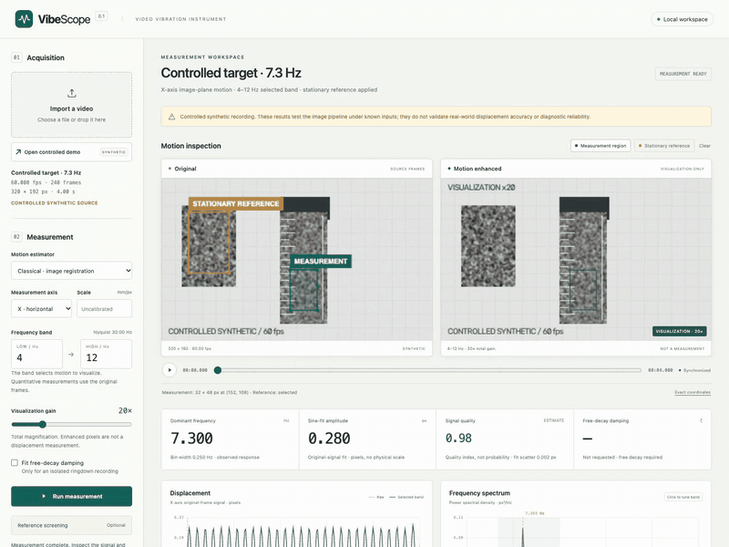
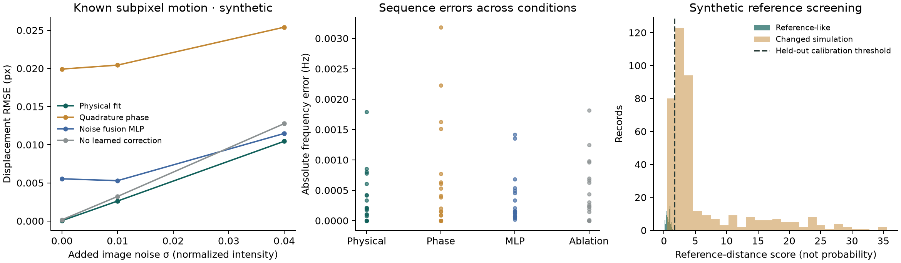

# VibeScope

[](https://github.com/nazeeh111/VibeScope/actions/workflows/ci.yml)

**A video vibration microscope built around measurement.**

Turn small image-plane motion into displacement histories, frequency spectra and selective motion visualizations. Runs locally on a CPU, with a compact trained motion estimator and reproducible comparisons against classical and neural methods.

> **Research release.** Controlled synthetic validation is included. Independent physical calibration and fault-diagnostic validation are pending. Magnified images are visualizations; measurements always come from original decoded frames.

[](docs/demo.mp4)

[Watch the demonstration](docs/demo.mp4) · [Workspace screenshot](docs/screenshots/workspace.png) · [Measurement guide](docs/MEASUREMENT.md) · [Benchmark evidence](docs/BENCHMARKS.md)

## Start locally

```bash
git clone https://github.com/nazeeh111/VibeScope.git
cd VibeScope
./setup.sh
./launch.sh
```

Open **http://127.0.0.1:8765**, choose **Load controlled demo**, inspect the moving and stationary regions, then run measurement. Python 3.11–3.14 is required. No cloud account, model API or paid service is used. First setup downloads free Python packages; processing stays local. If port 8765 is occupied, use `./launch.sh --port 8767`.

For Windows, use the equivalent Python commands in [installation](docs/INSTALLATION.md).

## A focused measurement workspace

- Import local MP4/MOV/AVI, select a textured measurement region and an independent stationary reference.
- Confirm the **capture frame rate**, choose x/y displacement and a frequency band below Nyquist.
- Inspect synchronized original/enhanced video, an activity map, raw/band-limited displacement and power spectrum.
- Read the dominant response frequency, sine-fit peak amplitude, tracking quality and resolution. Enter an in-plane mm/px scale when independently calibrated.
- Fit damping only for a declared isolated free ringdown. Screen novelty only against recordings from the same acquisition setup.
- Export CSV, plots, report JSON and videos. Every result retains parameters, source hash and evidence limitations.

The app refuses invalid bands, poor tracking, detected variable-rate timing and output collisions. Existing source recordings and completed result folders are never overwritten.

## Controlled evidence

The shipped decoded-video example contains a known **7.3 Hz, 0.28 px** translation plus camera motion. The original-frame pipeline recovers **7.29996 Hz and 0.27989 px** after reference subtraction. This validates that controlled clip, not physical machine accuracy.



The [full comparison](docs/BENCHMARKS.md) includes classical, phase, learned and real EulerMormer inference, ablations, noise, alternate textures, reference screening, uncertainty and failure cases.

## What is learned

`noise-fusion-mlp-v1` is a **362-parameter residual neural network** that learns bounded corrections to multiscale physical translation estimates. Its portable 4.3 KB checkpoint runs in NumPy. Training uses labeled subpixel translations, texture variation, lighting changes and noise, with disjoint texture seeds for training, calibration and testing.

On the shipped model's 1,500 held-out synthetic image pairs, vector displacement RMSE is **0.07705 px**, compared with **0.08428 px** without learned calibration. This is an 8.58% reduction against that ablation. It is **not** a claim of superiority over the stronger iterative classical tracker, which is the default. Sequence benchmarks include cases where the learned model is less accurate.

See the [model card](docs/MODEL_CARD.md), [benchmark results](docs/BENCHMARKS.md) and [research foundations](docs/FOUNDATIONS.md).

## Reproduce

The local release suite contains **50 passing tests**. CI also runs the real browser workflow, including H264 playback and reference screening.

```bash
.venv/bin/python -m pytest -q
.venv/bin/python scripts/benchmark.py --output experiments/reproduced
.venv/bin/python scripts/train_model.py --help
.venv/bin/python -m vibescope.cli --help
```

The optional [EulerMormer baseline](docs/FOUNDATIONS.md#optional-eulermormer-reproduction) verifies a pinned upstream checkpoint and supports CPU/MPS/CUDA. It is separate from core NumPy inference and is not bundled with the application. All measured comparisons state their scope, device and timing exclusions.

## Understand the boundary

A dominant response frequency does not establish structural resonance. A novelty score does not diagnose damage. Image-plane translation is not three-dimensional motion. An mm/px conversion does not include perspective or calibration uncertainty.

Rolling shutter, camera rotation, parallax, exposure blur, compression, unobserved aliased motion and out-of-plane movement can invalidate a result. A quiet-looking clip can still contain motion above Nyquist. The app cannot infer a trustworthy capture rate from slow-motion playback metadata alone.

The synthetic target is intentionally labeled as rendered input. There are no independently captured laboratory recordings or physical accuracy claims in this release. [Measurement guide](docs/MEASUREMENT.md) describes a ruler/cantilever validation protocol and acceptance evidence needed before making those claims.

## Project map

| Area | Entry point |
|---|---|
| Local workspace | `vibescope/static/`, `vibescope/server.py` |
| Original-frame tracking | `vibescope/motion.py`, `vibescope/learned.py` |
| Frequency and damping | `vibescope/signals.py` |
| Reference novelty screening | `vibescope/anomaly.py` |
| Rendering and exports | `vibescope/pipeline.py` |
| Training and comparisons | `scripts/`, `experiments/` |
| Tests and CI | `tests/`, `.github/workflows/ci.yml` |

## License and attribution

Original code, compact weights and synthetic examples are MIT licensed. Research context includes [STB-VMM](https://github.com/RLado/STB-VMM), [EulerMormer](https://github.com/VUT-HFUT/EulerMormer), [Axial-MM](https://github.com/kaist-ami/Axial-mm), [ViMag](https://github.com/RLado/ViMag) and [phase-based motion processing](https://people.csail.mit.edu/nwadhwa/phase-video/). Upstream model code/weights are external; Axial-MM is not incorporated or redistributed. See [third-party notices](THIRD_PARTY_NOTICES.md).
