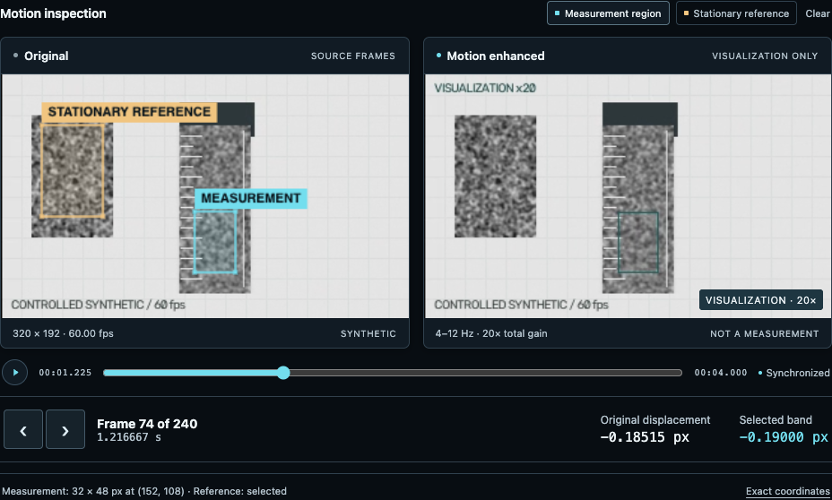
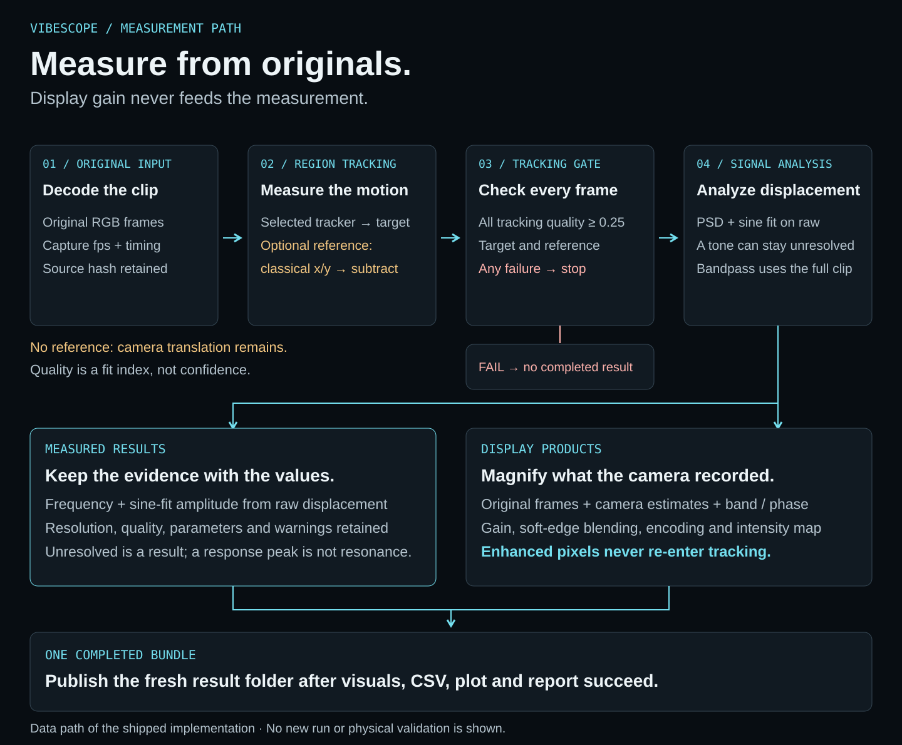
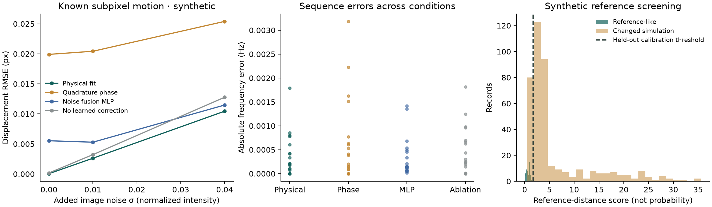

# VibeScope

Track vibration in an original video, subtract a stationary reference, and compare the displacement with a magnified playback. The two synchronized views share one measured trace.

[Run the controlled demo](#start-locally) · [Explore the recorded case](https://nazeeh111.github.io/work/vibescope/) · [Reopen saved work](#return-to-a-measurement) · [Measurement guide](docs/MEASUREMENT.md)

<picture>
  <source media="(max-width: 600px)" srcset="docs/presentation/frame-inspection-mobile.png">
  
</picture>

**Inspect frame 74.** Open the controlled demo and run the measurement. Scrub to 1.200 s, then choose **Next frame**. In the recorded run, sample time **1.216667 s** has original displacement **−0.18515 px** and selected-band displacement **−0.19000 px**. Open **Signal CSV** to check the `time_s`, `raw_displacement_px`, and `band_displacement_px` columns. Frame numbering starts at 1. The readout reports image-plane pixels even when a separate in-plane scale is supplied.

The example uses generated motion. A physical displacement measurement needs independently confirmed capture timing and in-plane calibration. Fault-diagnostic validation remains pending.

## One recording, two display gains

The [paired gain comparison](docs/presentation/measurement-story.svg) retains the two actual image/trace exports. The packaged target has known **7.3 Hz, 0.28 px** image-plane translation plus camera motion. Both runs recovered **7.29996 Hz and 0.27989 px** after stationary-reference subtraction. Amplitude is the fitted sinusoidal peak in the original displacement, not peak-to-peak travel or the motion shown by the enhanced video.

| Operation | What remains inspectable |
| --- | --- |
| Open the controlled demo | Synthetic source identity, source-pixel measurement and stationary-reference regions |
| Measure with gain 5, then gain 20 | Separate completed runs, equal measurement arrays, different visualization settings |
| Export | Displacement CSV, spectrum/plot, report JSON and synchronized video artifacts |
| Restart with the same workspace | Reopen the completed gain-20 run with its regions, band, metrics and display setting |

This November 17, 2026 browser journey ran current **0.1.1.dev0** source, including real synchronized playback and restart/reopen. The declared 60 fps synthetic target was used; this environment lacked `ffprobe`, so the report explicitly retains unverified presentation timing. No millimetre scale, physical calibration, resonance or diagnosis is claimed. [Gain-5 report](docs/presentation/gain5-report.json), [gain-20 report](docs/presentation/gain20-report.json), [gain-5 CSV](docs/presentation/gain5-displacement.csv) and [gain-20 CSV](docs/presentation/gain20-displacement.csv) retain the actual outputs.

[Inspect the current workspace](docs/presentation/workspace-current.png) or the retained [October 2026 playback clip](docs/demo-current.mp4), [desktop](docs/screenshots/workspace-current.png), [phone](docs/screenshots/workspace-mobile-current.png) and [capture details](docs/MEDIA.md). The retained release media and benchmarks keep their original source generation.

## Start locally

Current source is the unreleased **0.1.1.dev0** development version. The retained screenshots, benchmark receipts and 0.1.0 release artifacts describe their recorded source generations. Run `vibescope --version` to identify your installed command; new reports record `metadata.software_version`.

```bash
git clone https://github.com/nazeeh111/VibeScope.git
cd VibeScope
./setup.sh
./launch.sh
```

Open **http://127.0.0.1:8765**, choose **Open controlled demo**, inspect the moving and stationary regions, then run measurement. Python 3.11–3.14 is required. No cloud account, model API or paid service is used. First setup downloads free Python packages; processing stays local. If port 8765 is occupied, use `./launch.sh --port 8767`.

For Windows, use the equivalent Python commands in [installation](docs/INSTALLATION.md).

Prefer a command-line first run? After setup, generate a new synthetic recording
and measure it with the moving and stationary regions already specified:

```bash
.venv/bin/python -m vibescope.cli demo
.venv/bin/python -m vibescope.cli analyze runs/demo/controlled.mp4 \
  --output runs/demo-measurement --roi 152 108 32 48 \
  --reference-roi 32 40 48 72 --band 4 12 --synthetic
```

The generated target has a known 7.3 Hz, 0.28 px translation plus camera motion. `--roi` and `--reference-roi` use source pixels as `x y width height`; `--band 4 12` is in Hz. The `--synthetic` label is for generated inputs only.
The command prints the measured metrics and writes CSV, plots, JSON and playback
videos. Compare the estimates with that synthetic truth; this is not physical
validation. Existing recordings/results are preserved. To repeat, choose fresh
`--output` paths for both commands and use the new video path for analysis.

## A focused measurement workspace

- Import local MP4/MOV/AVI, select a textured measurement region and an independent stationary reference.
- Confirm the **capture frame rate**, choose x/y displacement and a frequency band below Nyquist.
- Inspect synchronized original/enhanced video, an activity map, raw/band-limited displacement and power spectrum.
- Read the dominant response frequency, sine-fit peak amplitude, tracking quality and resolution. Amplitude is a fitted peak in pixels, not peak-to-peak motion or magnified display displacement. Enter an in-plane mm/px scale when independently calibrated.
- Fit damping only for a declared isolated free ringdown. Screen novelty only against recordings from the same acquisition setup.
- Export CSV, plots, report JSON and videos. Every result retains parameters, source hash and evidence limitations.

The app refuses invalid bands, poor tracking, detected variable-rate timing and output collisions. Existing source recordings and completed result folders are never overwritten.

## Return to a measurement

The workspace keeps recordings and measurements in `runs/`. Choose **Local history → Refresh history**, open a recording, then select **Open completed run** to restore its regions, reference, timing, band and display settings. A new measurement creates a new run, preserving the prior result. After stopping the server, launch it with the **same data directory** to reopen that workspace:

```bash
./launch.sh --data-dir runs
.venv/bin/python -m vibescope.cli history --data-dir runs
.venv/bin/python -m vibescope.cli history --data-dir runs --recording RECORDING_UUID
.venv/bin/python -m vibescope.cli history --data-dir runs \
  --recording RECORDING_UUID --run RUN_UUID
```

Replace the UUID placeholders with IDs returned by history. The CLI returns JSON metadata; open the browser workspace to play a saved measurement. Standalone CLI `demo` and `analyze` outputs remain separate artifact folders and are not registered as workspace history. History inspects at most 100 directory entries per folder, including unrelated entries; it is not an exhaustive archive browser. Incomplete, changed or unsupported run publications cannot be opened as completed measurements. Legacy recording metadata may be listed without the newer source manifest.

History verifies bounded snapshots against local manifests. These hashes do not authenticate files or guarantee the separately served `/data` downloads still have those bytes when delivered. Keep independent backups of originals and useful outputs. See [installation and saved work](docs/INSTALLATION.md#saved-work-and-history).


## How measurement stays separate from display

<picture>
  <source media="(max-width: 600px)" srcset="docs/assets/measurement-path-portrait.svg">
  
</picture>

The optional stationary reference removes image-plane translation before signal analysis. Poor tracking stops the run; a well-tracked clip can still have no resolved periodic component. [Follow the implementation](docs/MEASUREMENT_PATH.md).

## Controlled evidence

The shipped decoded-video example contains a known **7.3 Hz, 0.28 px** translation plus camera motion. The original-frame pipeline recovers **7.29996 Hz and 0.27989 px** after reference subtraction. This validates that controlled clip, not physical machine accuracy.

A separate [external rotor recording check](docs/EXTERNAL_ROTOR.md) compares
one second of captured video with the frequency content of a published sensor
file. It resolves 33.35 Hz alongside 33.31 Hz peaks in three sensor channels,
with 1 Hz video resolution. Synchronization, patch-to-sensor correspondence and
physical amplitude accuracy are not established. The reproduction helper verifies
input hashes and preserves the original decoded crop pixels.



The [full comparison](docs/BENCHMARKS.md) includes classical, phase, learned and real EulerMormer inference, ablations, noise, alternate textures, reference screening, uncertainty and failure cases.

## What is learned

`noise-fusion-mlp-v1` is a **362-parameter residual neural network** that learns bounded corrections to multiscale physical translation estimates. Its portable 4.3 KB checkpoint runs in NumPy. Training uses labeled subpixel translations, texture variation, lighting changes and noise, with disjoint texture seeds for training, calibration and testing.

On the shipped model's 1,500 held-out synthetic image pairs, vector displacement RMSE is **0.07705 px**, compared with **0.08428 px** without learned calibration. This is an 8.58% reduction against that ablation. It is **not** a claim of superiority over the stronger iterative classical tracker, which is the default. Sequence benchmarks include cases where the learned model is less accurate.

See the [model card](docs/MODEL_CARD.md), [benchmark results](docs/BENCHMARKS.md) and [research foundations](docs/FOUNDATIONS.md).

## Reproduce

The current source suite includes measurement, refusal, history, same-byte snapshot and nonblocking named-pipe controls. The retained release receipts and browser captures keep their original scope; rerun the checks for this checkout. CI defines a browser workflow, including H264 playback and reference screening; a local source test pass does not establish a new hosted CI run.

```bash
.venv/bin/python -m pytest -q
.venv/bin/python scripts/benchmark.py --output experiments/reproduced
.venv/bin/python scripts/train_model.py --help
.venv/bin/python -m vibescope.cli --help
```

The optional [EulerMormer baseline](docs/FOUNDATIONS.md#optional-eulermormer-reproduction) verifies a pinned upstream checkpoint and supports CPU/MPS/CUDA. It is separate from core NumPy inference and is not bundled with the application. All measured comparisons state their scope, device and timing exclusions.

## Understand the boundary

A dominant response frequency does not establish structural resonance. A novelty score does not diagnose damage. Image-plane translation is not three-dimensional motion. An mm/px conversion does not include perspective or calibration uncertainty.

Rolling shutter, camera rotation, parallax, exposure blur, compression, unobserved aliased motion and out-of-plane movement can invalidate a result. A quiet-looking clip can still contain motion above Nyquist. The app cannot infer a trustworthy capture rate from slow-motion playback metadata alone.

The synthetic target is intentionally labeled as rendered input. The external
rotor case uses a public captured recording for a limited frequency-content
comparison; physical displacement accuracy remains unverified.
[Measurement guide](docs/MEASUREMENT.md) describes a ruler/cantilever validation
protocol and acceptance evidence needed before making accuracy claims.

## Project map

| Area | Entry point |
|---|---|
| Local workspace | `vibescope/static/`, `vibescope/server.py` |
| Original-frame tracking | `vibescope/motion.py`, `vibescope/learned.py` |
| Frequency and damping | `vibescope/signals.py` |
| Reference novelty screening | `vibescope/anomaly.py` |
| Rendering and exports | `vibescope/pipeline.py` |
| Training and comparisons | `scripts/`, `experiments/` |
| Tests and CI | `tests/`, `.github/workflows/ci.yml` |

## License

Core source, compact weights and synthetic examples use the [MIT license](LICENSE). External baseline code and weights retain their own terms.
