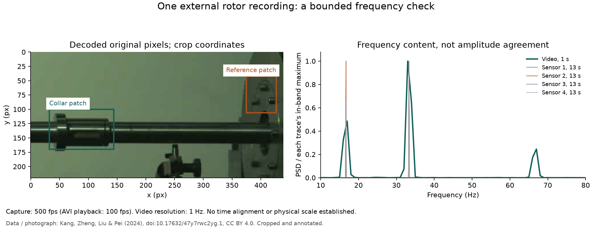

# One external rotor recording

This is a frequency-content check on a public captured video, not a calibrated
displacement benchmark. The selected patch includes a rotating collar. Its
appearance and illumination can repeat at the rotation frequency or harmonics;
agreement with a sensor peak alone does not prove translation accuracy.



## Recorded result

For `1000rpm-Unb1.avi`, the unchanged default classical tracker with a separate
reference patch resolved **33.35 Hz**, with **1 Hz** video FFT-bin spacing.
Within 10–80 Hz, independent Hann periodograms of the complete sensor file peak at **33.31 Hz**
in channels 1, 3 and 4, and **16.69 Hz** in channel 2. The sensor file spans
13 seconds; the video contains only one second of capture. These are different
record lengths and are **not time-aligned**. The recorded numbers, input hashes,
patches and resolver gates are in [comparison.json](../experiments/external-rotor/comparison.json).
The 33 Hz component is near twice the nominal 16.67 Hz rotation rate; the
dominant response need not be the rotation frequency.

The AVI reports **100 fps playback**, while the acquisition documentation says
**500 fps capture**. Use the documented capture rate explicitly. A uniform
presentation timestamp sequence does not independently verify the capture rate.
The patch and broad 10–80 Hz band were selected before inspecting sensor spectra.
No sensor channel was selected to optimize agreement. Gain is 1; measurements
come from the decoded recording, not magnified output.

There is no established channel-to-patch correspondence, synchronization or
in-plane physical scale here. The pixel amplitude is retained in the report,
but it is not compared with sensor amplitude. This check establishes neither
resonance nor fault detection, and does not validate the learned estimator.

## Reproduce

Download these **two individual files** from the dataset's `Raw videos` and
`Sensor data` folders:

- [1000rpm-Unb1.avi, 7.51 MB](https://data.mendeley.com/public-files/datasets/47y7rwc2yg/files/14158b3c-dc16-4da1-8453-7a7005b6a5e0/file_downloaded)
- [1000rpm-Unb1.csv, 1 MB](https://data.mendeley.com/public-files/datasets/47y7rwc2yg/files/39725cfa-82dc-4439-9ebd-a4a9189f34c7/file_downloaded)

From a configured VibeScope source checkout, substitute your downloaded paths:

```sh
PYTHONPATH=. .venv/bin/python scripts/rotor_case.py \
  --video /path/to/1000rpm-Unb1.avi \
  --sensors /path/to/1000rpm-Unb1.csv \
  --output runs/external-rotor
```

The helper verifies both published SHA-256 hashes. To stay within the existing
50-million-pixel processing limit, it crops the original to `(840,350,440,220)`
without resizing or skipping frames, using lossless FFV1. It decodes the crop
again and checks every pixel of all 500 frames against the original decoded
crop. It then calls the production measurement pipeline with the documented
500 fps rate, saves the full report/CSV/playback outputs, and compares frequency
content with all four sensor channels. Existing output folders are refused;
failed runs do not publish a completed result. This helper performs no download.

The source recording's published bytes were checked, not its physical acquisition
independently certified. Floating-point results can differ slightly by platform.
The existing [physical calibration protocol](MEASUREMENT.md) remains necessary
before claiming displacement accuracy.

## Dataset credit and rights

Kang, Wenjing; Zheng, Wenbin; Liu, Bingqing; Pei, Shiyuan (2024),
*Vibration Displacement Dataset of Rotors under Various Operational Conditions:
High-speed Camera Video Data and Eddy current displacement sensor data*,
Mendeley Data, V1, [doi:10.17632/47y7rwc2yg.1](https://doi.org/10.17632/47y7rwc2yg.1).
Dataset and the photograph used in the figure are **[CC BY 4.0](https://creativecommons.org/licenses/by/4.0/)**.
The figure crops and annotates the photograph and adds independently computed
spectra. Original video/sensor files are not bundled. The reproduction helper is
VibeScope code under its MIT license.

The authors warn against comparisons with saturated channels 2/3 at 2,000 rpm
and recommend only channel 4 for the ramp-up cases. Those cases are not evaluated
here; do not generalize this single steady-state result to them.
